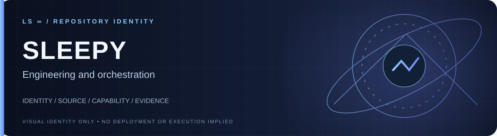

**Engineering and orchestration.**

[**Explore source**](.) · [**Repository details**](../../)

**Visibility:** `PUBLIC` · **Identity:** `LIVE IN GITHUB` · **Deployment:** `NOT ASSERTED BY BANNER`

---

# LS-sleepy
LS Sleepy - Engineering and Orchestration
